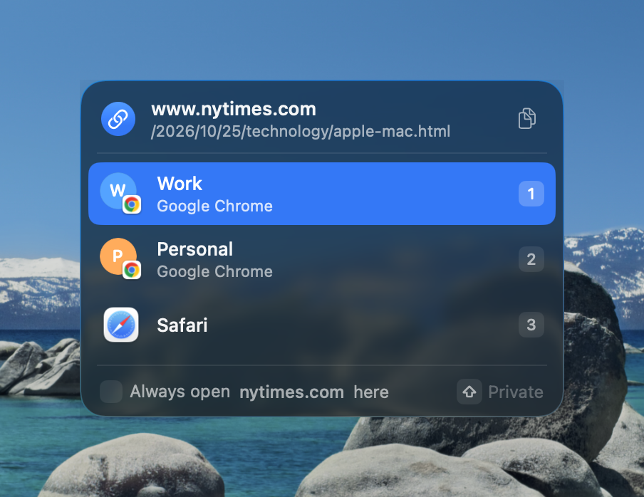
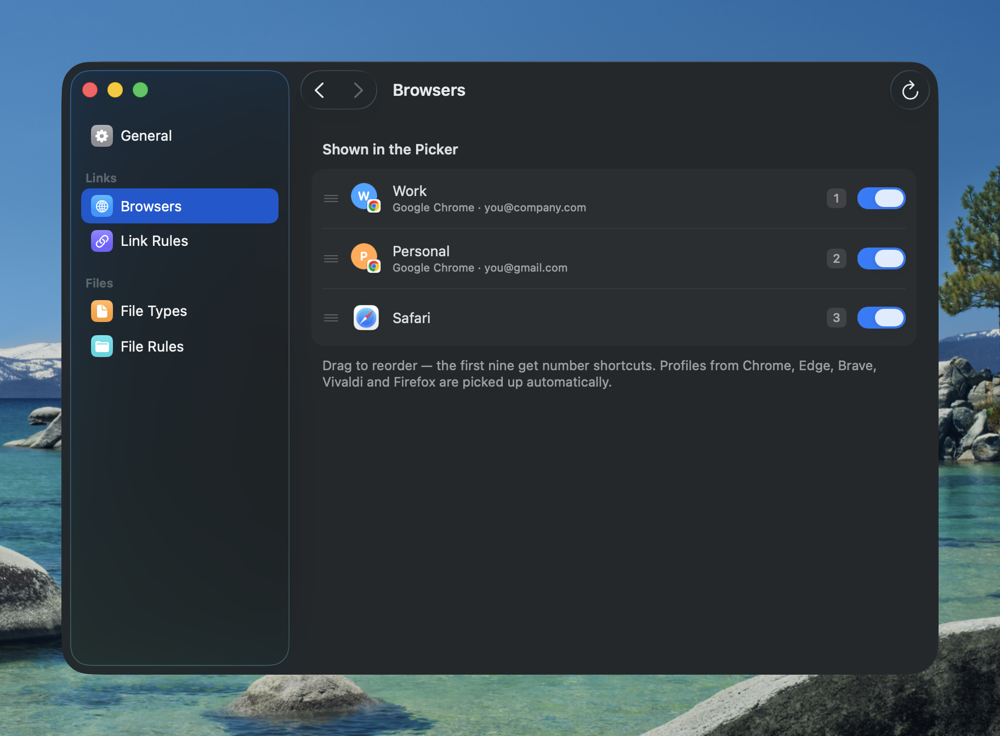
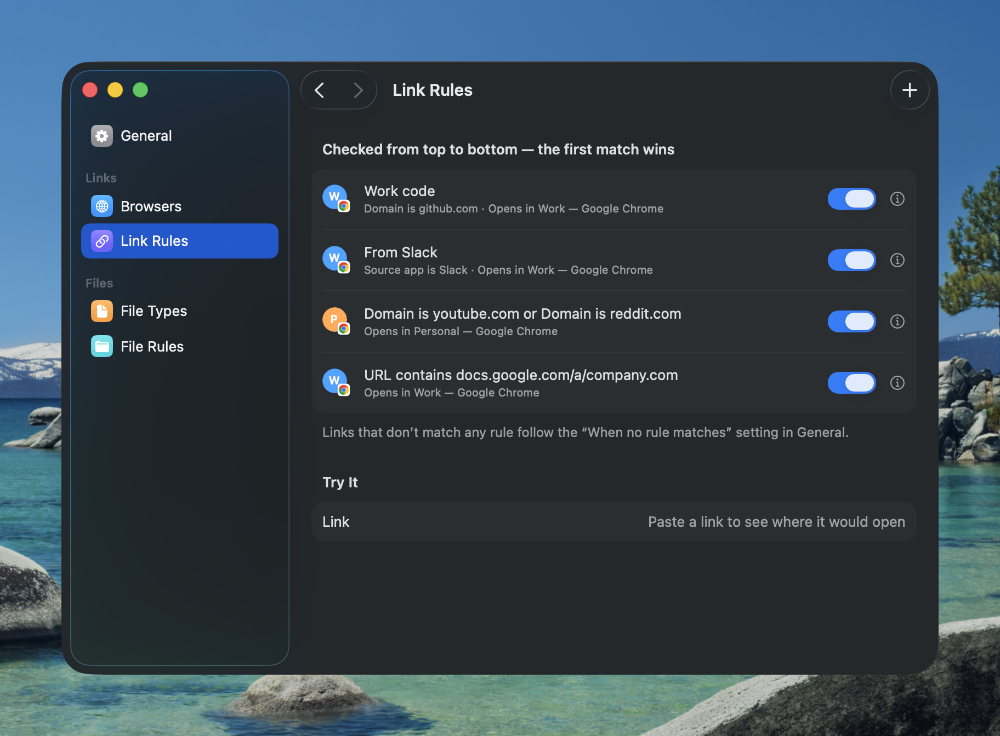
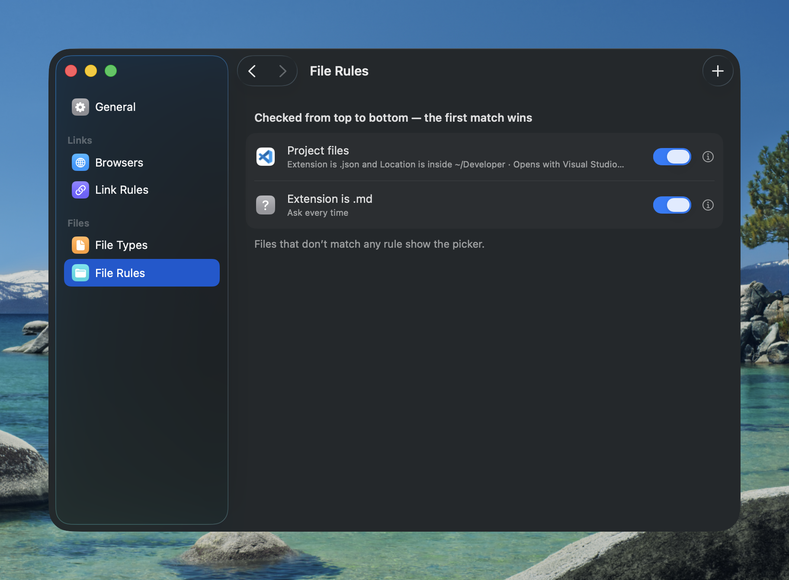
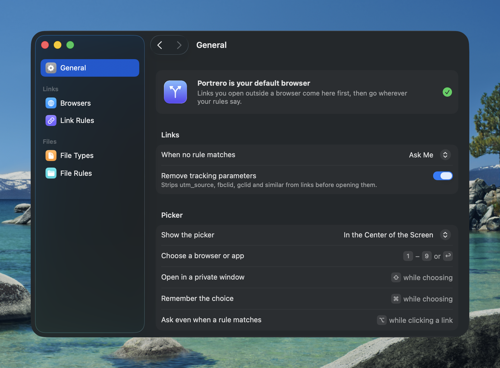

<p align="center">
  
</p>

<h1 align="center">Portrero</h1>

<p align="center">
  <strong>Open every link in the right browser profile — and every file in the right app.</strong>
</p>

<p align="center">
  <a href="https://github.com/sirmammingtonham/portrero/releases/latest"></a>
  <a href="https://github.com/sirmammingtonham/portrero/actions/workflows/ci.yml"></a>
  
</p>

---

Portrero sits between your Mac and your browsers. Make it the default browser and every link you
click — in Slack, Mail, Notes, a terminal — comes to Portrero first. Rules send it straight to the
right place (GitHub in your **Work** Chrome profile, YouTube in **Personal**); anything else shows a
small picker right under your pointer, so one keystroke opens it where you want.

It does the same for files. Hand it `.json`, `.md` or any other type, and double-clicking one asks
which app to use — or follows a rule like *“JSON files in ~/Developer open in VS Code.”*

<p align="center">
  
</p>

## Features

**Links**
- **Every browser profile, detected automatically** — Chrome, Edge, Brave, Vivaldi and Chromium
  profiles (with their avatars), Firefox, Zen and LibreWolf profiles, plus Safari and any other browser.
- **A picker that stays out of the way** — appears at the pointer (or screen center), closes the
  moment you click elsewhere, and hands focus straight back to the app you were in if you cancel.
- **Rules** by domain, full URL (contains, starts with, wildcard pattern or regex) and the **app the
  link came from**. Combine conditions with *all* or *any*; first match wins.
- **Private windows** in Chromium and Firefox browsers — hold <kbd>⇧</kbd> while choosing.
- **Remember a choice** without opening Settings — tick *Always open … here* (or hold <kbd>⌘</kbd>)
  and Portrero writes the rule for you.
- **Override any rule** — hold <kbd>⌥</kbd> while clicking a link to get the picker anyway.
- **Tracking parameters removed** — `utm_*`, `fbclid`, `gclid` and friends are stripped before the
  link opens.
- **Rule tester** — paste a link in Settings to see exactly where it would go and why.

**Files**
- **Choose per file type** which types Portrero handles. The app that used to open them is kept
  as the default in the picker, and is restored if you hand the type back.
- **File rules** by extension, location (*inside ~/Developer*), file name pattern or source app.
- **Several files at once** are grouped by the app each one is going to.

**Everything else**
- Native AppKit + SwiftUI, Liquid Glass on macOS 26, light and dark mode.
- Full keyboard control, with number keys for the first nine choices.
- Menu bar item with *Open Link from Clipboard*; optional launch at login.
- No network access, accounts or analytics. Settings are one JSON file you can read and back up.

<table>
  <tr>
    <td></td>
    <td></td>
  </tr>
  <tr>
    <td></td>
    <td></td>
  </tr>
</table>

## Install

1. Download **Portrero.dmg** from the [latest release](https://github.com/sirmammingtonham/portrero/releases/latest),
   open it and drag **Portrero** to **Applications**.
2. Open Portrero. If the release isn't notarized, macOS blocks it the first time — open
   **System Settings → Privacy & Security**, scroll down and click **Open Anyway**.
3. In **Settings → General**, click **Make Default** and confirm. Links now go through Portrero.
4. Optional: in **Settings → File Types**, add the file types you want to choose an app for.

Requires macOS 14 Sonoma or later, on Apple silicon or Intel.

## Using the picker

| Key | Action |
| --- | --- |
| <kbd>1</kbd> – <kbd>9</kbd> | Open in that browser or app |
| <kbd>↑</kbd> <kbd>↓</kbd> or <kbd>Tab</kbd>, then <kbd>Return</kbd> | Move the highlight and open |
| hold <kbd>⇧</kbd> | Open in a private window |
| hold <kbd>⌘</kbd> | Remember this choice as a rule |
| <kbd>⌘</kbd> <kbd>C</kbd> | Copy the link (or file) instead of opening it |
| <kbd>⌘</kbd> <kbd>,</kbd> | Open Settings |
| <kbd>Esc</kbd> | Cancel |
| hold <kbd>⌥</kbd> while clicking a link | Show the picker even if a rule matches |

The footer's **Always open … here** menu picks what gets remembered: the domain, links from the
app you clicked in, the file extension, the extension in that folder, or everything in that folder.

## Rules

Rules are checked from top to bottom and the first match wins. Drag to reorder; switch one off
without deleting it.

| Rules for | Condition | Operators |
| --- | --- | --- |
| Links | **Domain** | is · is not · contains |
| Links | **URL** | contains · starts with · matches pattern · matches regex |
| Links, files | **Source app** | is · is not |
| Files | **Extension** | is · is not (several at once: `json, yaml`) |
| Files | **Location** | is inside · is not inside |
| Files | **File name** | contains · matches pattern · matches regex |

- *Domain is `github.com`* also matches `gist.github.com`; `*.example.com` and `www.` are handled for you.
- Patterns use `*` as a wildcard (`*/pull/*`); regexes are case-insensitive.
- *Source app* is the app that asked macOS to open the link — handy for “everything from Slack
  opens in Work.”
- Links that match nothing follow **When no rule matches** in Settings → General: ask, or always
  open in one browser.

## Build from source

You need macOS 14 or later and Swift 6 with the macOS 26 SDK — Xcode 26, or just its Command Line
Tools (`xcode-select --install`).

```sh
git clone https://github.com/sirmammingtonham/portrero.git
cd portrero
scripts/build.sh --install   # build, copy to /Applications and launch
```

| Command | What it does |
| --- | --- |
| `scripts/build.sh` | Release build at `build/Portrero.app` |
| `scripts/build.sh --debug` | Debug build, with hooks for `scripts/debug.swift` |
| `scripts/build.sh --universal --version 1.2.0` | Apple silicon + Intel build, versioned |
| `scripts/package.sh` | `.dmg`, `.zip` and checksums from the last build |
| `scripts/test.sh` | Unit tests (works with Xcode or the Command Line Tools) |

The screenshots above use made-up profiles and rules: launch a debug build with `--demo`, then
`swift scripts/debug.swift shot <file.png>` captures just Portrero's window over the desktop picture.

### Releases

Pushing a version tag builds, tests, packages and publishes a GitHub release with the DMG, zip and
checksums attached:

```sh
git tag v1.0.0
git push origin v1.0.0
```

Tags with a suffix such as `v1.1.0-beta.1` become pre-releases. To ship signed and notarized
builds, add these repository secrets; without them, releases are ad-hoc signed:

| Secret | Value |
| --- | --- |
| `MACOS_CERTIFICATE` | Base64 of your *Developer ID Application* `.p12` (`base64 -i cert.p12 \| pbcopy`) |
| `MACOS_CERTIFICATE_PASSWORD` | The `.p12` password |
| `CODESIGN_IDENTITY` | e.g. `Developer ID Application: Jane Doe (TEAMID1234)` |
| `NOTARY_APPLE_ID` | Apple ID used for notarization |
| `NOTARY_TEAM_ID` | Your 10-character team ID |
| `NOTARY_PASSWORD` | An [app-specific password](https://support.apple.com/102654) for that Apple ID |

### Project layout

```
Sources/PortreroCore   Rules, matching, link cleaning and profile parsing — plain Foundation, unit tested
Sources/Portrero       The app: routing, picker, settings, menu bar
Tests                  swift-testing suites for PortreroCore
Support                Info.plist and app icon
scripts                Build, package, test and debug helpers
```

## Uninstall

1. In **Settings → File Types**, remove each type so its previous app becomes the default again.
2. Choose another default browser in **System Settings → Desktop & Dock → Default web browser**.
3. Quit Portrero from its menu bar icon, then delete `/Applications/Portrero.app` and
   `~/Library/Application Support/Portrero`.

## Privacy

Portrero never connects to the internet. It reads browser profile lists from each browser's own
files in `~/Library/Application Support`, and stores its settings in
`~/Library/Application Support/Portrero/config.json`.
